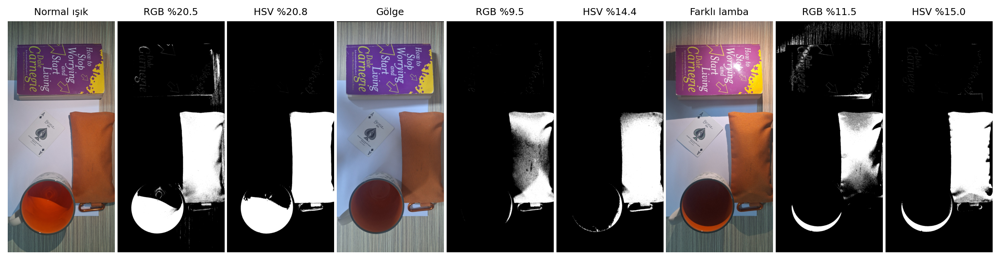

# YZM 411 Bilgisayarlı Görü — Ödev 1: Renk, Aydınlatma ve Örnekleme

**Öğrenci:** Muhammed Emin Erdağ — **No:** 230212013

Kendi kurduğum masaüstü sahnesinin üç fotoğrafında (normal ışık, gölge, farklı lamba) şu dört konuyu ölçerek inceledim:

| Hedef | Deney | Ana bulgu |
|---|---|---|
| H1 | Görüntünün sayısal yapısı, `img[y, x, kanal]`, BGR→RGB, üç pikselin değerleri | Gölgede R düştü ama **B arttı**. Lambada otomatik beyaz dengesi sıcak ışığı nötrledi. |
| H2 | Dondurulmuş RGB ve HSV eşikleri, 6 maske | Gölgede RGB maskesi %20,5 → %9,5'e düştü, HSV %14,4'te kaldı. Lambada sarımsı ahşap RGB eşiğini geçti. Turuncu çay iki uzayda da seçildi. |
| H3 | Parlaklık kaydırması (b = +40) ve gama (γ = 0,5 / 2,0) | Kırpılma neredeyse hiç olmadı (%0,39). Gama ortalaması Jensen eşitsizliği nedeniyle `255·(m/255)^γ`'dan saptı. |
| H4 | 1/4 küçültme (`INTER_NEAREST` / `INTER_AREA`) | Harfler 12 px'ten 3 px'e indi. NEAREST sahte desen üretti, AREA yazıyı griye çevirdi; büyütme ayrıntıyı geri getirmedi. |

📄 **Rapor (PDF, 2 sayfa):** [`rapor/Muhammed_Emin_Erdag_Odev.pdf`](rapor/Muhammed_Emin_Erdag_Odev.pdf) — LaTeX kaynağı: [`rapor/overleaf/main.tex`](rapor/overleaf/main.tex)
📊 **Tahmin–ölçüm tablosu:** [`results/sonuc_tablosu.csv`](results/sonuc_tablosu.csv)



## Dosya yapısı

```
├── odev1.ipynb            # çalıştırılabilir defter (tahminler, ölçümler, yorumlar)
├── odev1.py               # aynı defterin komut satırı sürümü (nbconvert --to script)
├── requirements.txt       # paket sürümleri
├── data/                  # giriş fotoğrafları: normal.jpg, golge.jpg, lamba.jpg
├── outputs/               # şekiller (fig0–fig5)
├── results/               # ham ölçümler: CSV tablolar + olcumler.json
├── rapor/                 # Muhammed_Emin_Erdag_Odev.pdf ve overleaf/ (main.tex + şekiller)
└── KAYNAK_BEYANI.md       # kaynaklar, araç ve yapay zekâ beyanı
```

## Çalıştırma

```bash
pip install -r requirements.txt
jupyter nbconvert --to notebook --execute odev1.ipynb   # ya da Jupyter'de: Kernel → Restart & Run All
# alternatif: python odev1.py
```

Çalıştırma sırası: hücreler yukarıdan aşağıya sırayla çalışır.
1. Sürümler ve parametreler
2. Fotoğrafların yüklenmesi, EXIF okuma ve hizalama
3. H1 → H2 → H3 → H4
4. Özet tablo

Tüm parametreler (piksel koordinatları, bölgeler, dondurulmuş eşikler, b, γ, küçültme oranı) defterin **Parametreler** hücresindedir.

**Kullanılan sürümler:** Python 3.13.12, NumPy 2.4.4, OpenCV 5.0.0, Matplotlib 3.10.9, pandas 3.0.2, Pillow 12.2.0.

## Yöntem notları

- **Kamera:** Samsung Galaxy A54 5G. Otomatik pozlama ve otomatik beyaz dengesi **açıktı**: gölgede pozlama süresi × ISO normalin 2,64 katı. Bu nedenle fotoğraflar arasındaki fark yalnızca ışıktan kaynaklanmıyor.
- **Hizalama:** Telefon çekimler arasında biraz kaydı. Gölge ve lamba fotoğrafları normal fotoğrafa SIFT + RANSAC homografisiyle hizalandı (ortanca hata < 1 px). `INTER_NEAREST` kullanıldığı için yeni renk değeri üretilmedi. Alan oranları üç fotoğrafın ortak görüş alanı üzerinden hesaplandı.
- **Eşikler:** Eşikler yalnızca normal ışıktaki kalemlik bölgesinden türetildi ve dondurularak üç fotoğrafa aynen uygulandı:
  - RGB: R 115–230, G 30–145, B 0–95
  - HSV: H 5–16, S ≥ 125, V ≥ 80
- **Alan oranı:** Maske alan oranı bir doğruluk ölçütü **değildir**.

## Kaynaklar ve yapay zekâ beyanı

Bkz. [`KAYNAK_BEYANI.md`](KAYNAK_BEYANI.md).
